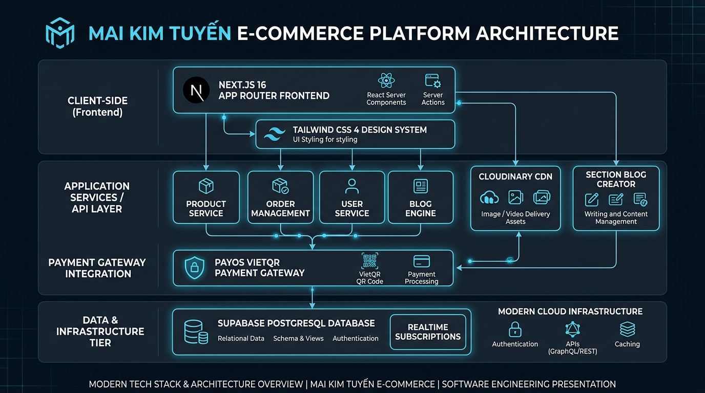
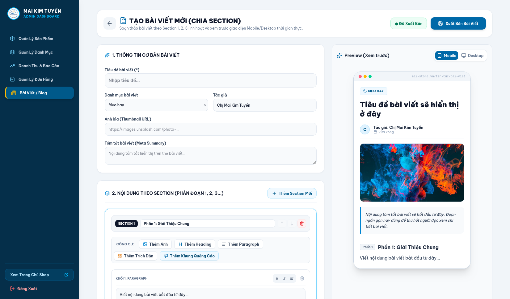
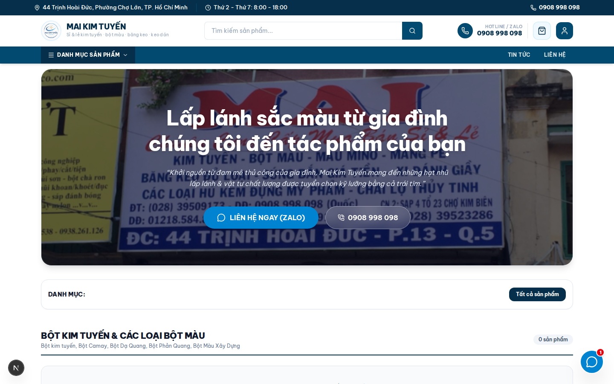

<div align="center">

# Enterprise E-Commerce Platform & Section Content Engine

A modern, high-performance web architecture built on Next.js 16 (App Router), React 19, TypeScript, and Supabase. Engineered for high-throughput product management, dynamic section-based content publishing, and automated VietQR transaction settlements via PayOS integration.

<p align="center">
  
  
  
  
  
  
</p>

</div>

---

## Architecture Overview



---

## Core System Modules

### 1. Section-Based Content Engine & Dual-Device Live Preview
A modular content management subsystem enabling non-technical users to construct structured long-form content using discrete section blocks (Section 1, Section 2, Section N).
- **Block-Based Composition**: Native support for Headings (H2/H3), Paragraphs, Image Assets with Captions, Blockquotes, and In-Line Promotional Banners.
- **Dual-Device Viewport Engine**: Real-time side-by-side rendering previewing mobile (`375px`) and desktop viewports instantaneously.
- **Intersectional Ad Slots**: Native capability to inject promotional cards between content sections.



### 2. Storefront Experience & Merchandising Dashboard
- **Storefront Client**: High-performance storefront client featuring server-side rendering, dynamic category filtering, and semantic article display.
- **Drag-and-Drop Reordering**: Interactive featured product prioritization powered by `@hello-pangea/dnd`.
- **Automated Settlement Gateway**: Synchronous VietQR generation and webhook-driven transaction reconciliation powered by PayOS API.



---

## Technology Stack

| Layer | Technology | Specification / Purpose |
| :--- | :--- | :--- |
| **Frontend Framework** | Next.js 16 (App Router) | React Server Components (RSC), Turbopack compilation |
| **UI Library & Language** | React 19 / TypeScript 5 | Component-driven architecture with strict static typing |
| **Styling Engine** | Tailwind CSS v4 | Utility-first design system with CSS custom properties |
| **Database & Security** | Supabase (PostgreSQL) | Relational persistence with Row-Level Security (RLS) policies |
| **Settlement Gateway** | PayOS Open API | Direct bank-transfer VietQR creation and webhook verification |
| **Asset Delivery** | Cloudinary CDN | Edge-cached image delivery and transformation pipeline |
| **Interactivity & Icons** | `@hello-pangea/dnd`, Lucide | Accessible drag-and-drop mechanics & SVG icon primitives |

---

## System Requirements & Installation

### Prerequisites
- Node.js `v18.17.0` or higher
- npm `v9.0.0` or higher

### Environment Configuration
Create `.env.local` in the project root directory:

```env
# Infrastructure - Supabase
NEXT_PUBLIC_SUPABASE_URL=https://your-supabase-instance.supabase.co
NEXT_PUBLIC_SUPABASE_ANON_KEY=your_supabase_anon_key

# Payment Gateway - PayOS
PAYOS_CLIENT_ID=your_client_id
PAYOS_API_KEY=your_api_key
PAYOS_CHECKSUM_KEY=your_checksum_key

# CDN Services - Cloudinary
CLOUDINARY_CLOUD_NAME=your_cloud_name
CLOUDINARY_API_KEY=your_api_key
CLOUDINARY_API_SECRET=your_api_secret
```

### Installation Steps
```bash
# Clone the repository
git clone https://github.com/QuocAnh242/mai-shop-prj.git
cd mai-shop-prj

# Install dependencies
npm install

# Seed initial database state
node scripts/seed-supabase.mjs

# Launch local server
npm run dev
```

---

## Directory Structure

```text
mai-shop-prj/
├── public/
│   └── readme/               # Platform architecture & screenshot assets
├── scripts/                  # Data ingestion & schema seeding scripts
├── src/
│   ├── app/                  # Next.js App Router hierarchy
│   │   ├── (storefront)/     # Public client routes & article renderer
│   │   ├── admin/            # Administrative management dashboard
│   │   └── api/              # Webhook listeners & REST endpoint routes
│   ├── features/             # Business domain components (Section Editor, Preview)
│   ├── shared/               # State context, TypeScript definitions, constants
│   └── lib/                  # Database SDK & third-party client instances
├── supabase/                 # Relational schema definitions & migration SQL
└── package.json
```

---

## License

Distributed under the MIT License.
