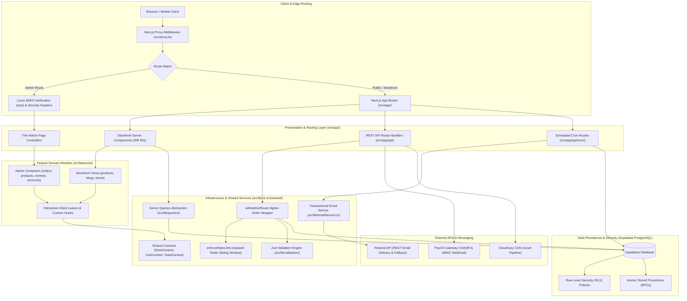

# Enterprise E-Commerce Platform & Section Content Engine

A modern, high-performance web architecture built on Next.js 16 (App Router), React 19, TypeScript, and Supabase (PostgreSQL). Engineered for high-throughput product management, dynamic section-based content publishing, enterprise-grade security hardening, automated VietQR transaction settlements via PayOS integration, and transactional reporting digests via Resend API.

---

## 1. System Architecture

The platform is structured according to **Layered Clean Architecture** and **Domain-Driven Design (DDD)** principles, enforcing strict separation of concerns across presentation, domain logic, data access, and infrastructure.



### Core Architecture Principles

1. **Strict Layer Decoupling**: Page routes in `src/app/` act purely as thin controllers. They assemble metadata, fetch initial server data, or render domain containers from `src/features/`. Business workflows and UI implementations never reside in route definitions.
2. **Defense-in-Depth Security**: Requests traverse multiple defensive gates:
   - Edge Proxy: Validates security headers and checks cryptographic JWT signatures locally.
   - API Wrapper (`withAdminRoute`): Executes sliding-window rate limiting and verifies admin authorization.
   - Validation Layer: Parses all payloads with strict Zod schemas before touching business logic.
   - Database Layer: Protected by PostgreSQL Row-Level Security (RLS) and atomic RPC functions.
3. **Hybrid Rendering Strategy**:
   - Storefront Catalog & Blog: React Server Components (RSC) with Incremental Static Regeneration (ISR `revalidate = 60`) for sub-millisecond edge response times and full search engine indexability (dynamic JSON-LD schema).
   - Admin Dashboard & Interactive Views: Client components loaded within thin server wrappers, preserving responsive UI states, optimistic updates, and drag-and-drop merchandising.
4. **Resilient Notification Infrastructure**:
   - Asynchronous transactional digests and automated maintenance warnings dispatched via Resend API.
   - Intelligent DNS fallback mechanism ensuring zero dropped alerts during custom domain propagation.
5. **Natural, Human-Crafted UI Standards**:
   - Strict rejection of over-decorated "AI slop" (no arbitrary glowing gradients, no glassmorphism blur stacks, zero decorative emojis).
   - Standardized iconography exclusively using `lucide-react` with uniform stroke widths.
   - Flat, high-contrast design tokens based on clean modern Scandinavian e-commerce aesthetics.

---

## 2. Directory Hierarchy & Architectural Boundaries

```text
mai-shop-prj/
├── public/                     # Static media, branded assets, and README media
├── scripts/                    # Administrative CLI tools & connection diagnostics
├── src/
│   ├── app/                    # Next.js 16 App Router (Routing & Controllers only)
│   │   ├── (storefront)/       # Public storefront layout, pages, and dynamic catch-all routes
│   │   │   ├── products/       # Product catalog & ISR product detail routes
│   │   │   ├── news/           # Blog & section-based editorial articles
│   │   │   ├── cart/           # Shopper checkout & cart review page
│   │   │   └── page.tsx        # Storefront home page (Server Component)
│   │   ├── admin/              # Administrative control center pages (thin controllers)
│   │   │   ├── products/       # Product catalog manager controller
│   │   │   ├── orders/         # Order management controller
│   │   │   ├── reviews/        # Moderation dashboard controller
│   │   │   ├── accounts/       # Admin credentials controller
│   │   │   └── login/          # Secure admin login portal
│   │   ├── api/                # Edge and REST API route handlers
│   │   │   ├── admin/          # Admin CRUD endpoints (protected by withAdminRoute)
│   │   │   ├── auth/           # Login, logout, and token session renewal
│   │   │   ├── cron/           # Scheduled cron endpoints (analytics cleanup & Resend digest)
│   │   │   ├── payos/          # Payment creation and HMAC-verified webhook handlers
│   │   │   ├── reviews/        # Customer feedback submission with profanity filter
│   │   │   └── upload/         # Binary-validated image upload endpoint
│   │   ├── layout.tsx          # Root HTML layout with context providers
│   │   └── not-found.tsx       # Standardized 404 error page
│   ├── features/               # Domain-Driven Feature Modules
│   │   ├── admin/              # Admin feature packages (modularized containers & hooks)
│   │   │   ├── accounts/       # AccountsManager container
│   │   │   ├── blogs/          # BlogSectionEditor, BlogLivePreview
│   │   │   ├── orders/         # OrdersTable container, useOrders custom hook
│   │   │   ├── products/       # ProductsManager, ProductFormModal, DragDropProductList
│   │   │   └── reviews/        # ReviewsManager, ReviewCard, ReviewModals
│   │   ├── blogs/              # BlogDetailView, SectionRenderer, ArticleCard
│   │   ├── products/           # ProductDetailView, ProductCard, ProductGrid
│   │   ├── cart/               # CartDrawer, CartSummary, CartItemRow
│   │   ├── checkout/           # CheckoutModal, QuickBuyModal, VietQRDisplay
│   │   └── home/               # HeroBanner, CategoryShowcase, FeaturedBanners
│   ├── lib/                    # Reusable Core Infrastructure & System Services
│   │   ├── api/                # API wrappers (withAdminRoute, standardized responses)
│   │   ├── queries/            # Server-side data fetchers for RSC and ISR (products, blogs)
│   │   ├── validation/         # Zod schemas for request validation and data contracts
│   │   ├── adminAuth.ts        # Admin authorization and session cookie applicator
│   │   ├── emailService.ts     # Resend API client, dynamic superadmin resolver, and email templates
│   │   ├── ids.ts              # Collision-safe CSPRNG entity ID and order code generator
│   │   ├── imageValidation.ts  # Magic-byte file sniffing and MIME verification
│   │   ├── jwtVerify.ts        # In-process JWKS cryptographic token verification
│   │   ├── moderation.ts       # Profanity detection and contextual content moderation
│   │   ├── payosSignature.ts   # HMAC-SHA256 signature generation and checksum checks
│   │   ├── rateLimit.ts        # Distributed sliding-window rate limiter (Redis / memory)
│   │   └── supabase.ts         # Supabase client singletons (anon client & service role)
│   ├── shared/                 # Cross-Cutting Shared State & TypeScript Types
│   │   ├── context/            # StoreContext, CartContext, ToastContext
│   │   ├── types/              # Domain entities (Product, Order, Review, Article, etc.)
│   │   └── initialData.ts      # Default store configurations, categories, and fallbacks
│   ├── components/             # Primitive UI Components & Shared Shell Elements
│   │   ├── layout/             # TopBar, Header, NavigationBar, Footer
│   │   └── ui/                 # Loading skeletons, base buttons, and modal dialogs
│   └── proxy.ts                # Next.js proxy middleware (security headers & route guard)
├── supabase/
│   ├── migrations/             # Version-controlled, idempotent SQL migrations
│   │   ├── 0001_baseline_schema.sql
│   │   ├── 0002_fix_orders_rls_and_is_admin.sql
│   │   └── 0003_reorder_products_and_indexes.sql
│   └── legacy/                 # Historical database script archives
├── tests/                      # Automated Vitest Test Suite
│   ├── unit/                   # Unit tests (schemas, crypto, rateLimit, IDs, email, queries)
│   └── integration/            # Integration workflows (PayOS webhooks, auth lifecycle)
├── vitest.config.ts            # Test runner configuration with path aliases
└── package.json                # Project dependencies, scripts, and build harness
```

### Module Boundary Matrix

| Directory         | Can Import From                               | Must NOT Import From               | Responsibility                                                            |
| :---------------- | :-------------------------------------------- | :--------------------------------- | :------------------------------------------------------------------------ |
| `src/app/`        | `features/`, `lib/`, `shared/`, `components/` | None (Top level)                   | Routing, HTTP serialization, layouts, metadata generation                 |
| `src/features/`   | `lib/`, `shared/`, `components/`              | `app/`                             | Feature containers, domain hooks, interactive UI components               |
| `src/lib/`        | `shared/types/`                               | `app/`, `features/`, `components/` | Infrastructure, database queries, security, encryption, validation, email |
| `src/shared/`     | External utility packages                     | `app/`, `features/`, `lib/`        | Shared TypeScript types, React Context definitions                        |
| `src/components/` | `shared/types/`                               | `app/`, `features/`, `lib/api/`    | Stateless UI primitives (buttons, spinners, headers, footers)             |

---

## 3. Core Modules, Classes & Interfaces

### 3.1 `withAdminRoute` (`src/lib/api/withAdminRoute.ts`)

A higher-order route handler wrapper designed to standardize security, rate limiting, and session refreshing across all administrative REST endpoints.

```typescript
export interface RouteContext {
  req: NextRequest;
  auth: AdminAuthResult;
}

export interface AdminRouteOptions {
  /** Rate limit configuration per client IP. Pass null to disable. */
  rateLimit?: { key: string; limit: number; windowSeconds: number } | null;
  /** Requires configured SUPABASE_SERVICE_ROLE_KEY (defaults to true). */
  requireServiceRole?: boolean;
}

export function withAdminRoute(
  options: AdminRouteOptions,
  handler: (ctx: RouteContext) => Promise<NextResponse>,
): (req: NextRequest) => Promise<NextResponse>;
```

- **Lifecycle Execution Flow**:
  1. **Rate Limiting**: Checks `enforceRateLimit(key + IP)`. Returns HTTP `429` on exhaustion.
  2. **Authentication Guard**: Verifies cryptographic JWT via `verifyAdminAuth(req)`. Returns HTTP `401` on invalid or expired credentials.
  3. **Service Role Verification**: Confirms server-side service credentials exist. Returns HTTP `500` if unconfigured.
  4. **Business Logic Execution**: Executes handler and catches unexpected errors, returning standardized HTTP `500` JSON payloads.
  5. **Session Renewal**: Seamlessly attaches updated refresh/access cookies to the response if the token was rotated.

### 3.2 `enforceRateLimit` (`src/lib/rateLimit.ts`)

A resilient, distributed rate limiter employing the sliding-window algorithm.

```typescript
export interface RateLimitResult {
  allowed: boolean;
  remaining: number;
  resetSeconds: number;
}

export async function enforceRateLimit(
  identifier: string,
  limit: number,
  windowSeconds: number,
): Promise<RateLimitResult>;
```

- **Architecture**: Connects to Upstash Redis via `@upstash/ratelimit` in serverless/production environments. Automatically falls back to a clean in-memory sliding-window store during local development or when Redis credentials are not provided.

### 3.3 `verifyAdminTokenLocally` (`src/lib/jwtVerify.ts`)

Cryptographic token verification implemented using `jose`.

```typescript
export interface AdminTokenPayload {
  sub: string;
  email?: string;
  role?: string;
  exp: number;
  [key: string]: unknown;
}

export async function verifyAdminTokenLocally(
  token: string,
): Promise<AdminTokenPayload | null>;
```

- **Performance Advantage**: Verifies access tokens directly against Supabase Auth JWKS public keys without performing network HTTP roundtrips on the request hot path.

### 3.4 Server Query Abstraction (`src/lib/queries/`)

Encapsulated data access functions for React Server Components (RSC) and Incremental Static Regeneration (ISR).

```typescript
// src/lib/queries/products.ts
export async function getProducts(options?: {
  categoryId?: string;
  limit?: number;
}): Promise<Product[]>;

export async function getProductBySlug(
  slugParam: string | string[],
): Promise<Product | null>;

export async function getRelatedProducts(
  currentProductId: string,
  categoryId: string,
  limit?: number,
): Promise<Product[]>;

// src/lib/queries/blogs.ts
export async function getBlogArticles(): Promise<Article[]>;
export async function getBlogBySlug(slug: string): Promise<Article | null>;
```

- Uses `supabaseAdmin` directly on the server to bypass RLS latency for public reading while maintaining absolute data sanitization.

### 3.5 Transactional Email Service (`src/lib/emailService.ts`)

High-reliability transactional email delivery built directly on top of the Resend REST API (`https://api.resend.com/emails`).

```typescript
export interface SendCleanupReportParams {
  toEmails: string[];
  totalViewsLast30Days: number;
  totalVisitorsLast30Days: number;
  topProducts: { title: string; views: number }[];
  plannedCleanupDate: string;
}

export async function sendCleanupNoticeEmail(
  params: SendCleanupReportParams,
): Promise<{
  success: boolean;
  messageId?: string;
  error?: string;
}>;

export async function getSuperadminEmails(): Promise<string[]>;
```

- **Intelligent DNS Fallback**: When sending via the custom domain (`thongbao@maikimtuyen.io.vn`) encounters pending DNS verification or an unverified domain status (`403` or `verify a domain` response from Resend), the service automatically switches to `onboarding@resend.dev` and directs the dispatch to registered administration inboxes. This guarantees that zero critical maintenance alerts are lost during DNS migrations.
- **Dynamic Recipient Resolution**: Resolves administrator inboxes directly from Supabase Auth (`supabaseAdmin.auth.admin.listUsers()`), deduplicates email addresses, and falls back gracefully to `DEFAULT_SUPERADMIN_EMAILS` when database auth is unreachable.

### 3.6 Validation Engine (`src/lib/validation/schemas.ts`)

Centralized Zod contract definitions validating all inbound payloads before mutation.

- `LoginSchema`: Email format and password complexity.
- `CreateOrderSchema`: Numeric order codes, positive amounts, and customer contact data.
- `CreateReviewSchema`: Rating limits (1 to 5 stars), bounded author names, and content length.
- `PayOSWebhookPayloadSchema`: Webhook data integrity and HMAC checksums.

### 3.7 Collision-Safe Identifiers (`src/lib/ids.ts`)

Enterprise ID generation replacing problematic `Date.now()` patterns that collide under concurrent traffic.

- `generateEntityId(prefix?: string)`: Generates CSPRNG UUID strings (e.g., `p_9b1deb4d-3b7d-4bad-9bdd-2b0d7b3dcb6d`).
- `generateOrderCode()`: Generates human-readable, unique transaction identifiers (`MKT` + base36 timestamp + hex randomizer).
- `extractPayOSOrderNumber(orderCode: string)`: Generates a stable, 48-bit unsigned integer from the SHA-256 hash to satisfy PayOS numeric requirements.

---

## 4. Architecture Implementation Examples

### Example 1: Secure Admin API Route Pattern

Demonstrates authoring an admin endpoint utilizing `withAdminRoute`, Zod payload validation, and atomic database execution.

```typescript
// src/app/api/admin/products/route.ts
import { NextRequest } from "next/server";
import { supabaseAdmin } from "@/lib/supabase";
import { generateEntityId } from "@/lib/ids";
import { withAdminRoute, ok, fail } from "@/lib/api/withAdminRoute";
import { z } from "zod";

const UpdateProductSchema = z.object({
  title: z.string().min(2, "Tên sản phẩm tối thiểu 2 ký tự"),
  price: z.number().nonnegative("Giá không được âm"),
  categoryId: z.string().min(1, "Thiếu danh mục"),
  inStock: z.boolean().default(true),
});

export const POST = withAdminRoute(
  {
    rateLimit: { key: "adm_prod_create", limit: 60, windowSeconds: 60 },
    requireServiceRole: true,
  },
  async ({ req, auth }) => {
    const rawBody = await req.json();
    const parseResult = UpdateProductSchema.safeParse(rawBody);

    if (!parseResult.success) {
      return fail("VALIDATION_ERROR", 400, parseResult.error.errors[0].message);
    }

    const { title, price, categoryId, inStock } = parseResult.data;
    const newId = generateEntityId("p");

    const { data, error } = await supabaseAdmin!
      .from("products")
      .insert([
        {
          id: newId,
          title: title.trim(),
          price,
          category_id: categoryId,
          in_stock: inStock,
        },
      ])
      .select()
      .single();

    if (error) {
      return fail("DB_ERROR", 500, error.message);
    }

    return ok(data, { newSession: auth.newSession });
  },
);
```

### Example 2: Feature Module Pattern (Thin Controller & Container)

Demonstrates how page routes remain under 10 lines of code by delegating presentation and business logic to `src/features/`.

#### 1. Thin Page Controller

```typescript
// src/app/admin/orders/page.tsx
import React from "react";
import { OrdersTable } from "@/features/admin/orders/OrdersTable";

export default function AdminOrdersPage() {
  return <OrdersTable />;
}
```

#### 2. Domain Hook

```typescript
// src/features/admin/orders/useOrders.ts
import { useState, useEffect, useCallback } from "react";
import { Order } from "@/shared/types";

export function useOrders() {
  const [orders, setOrders] = useState<Order[]>([]);
  const [loading, setLoading] = useState(true);
  const [page, setPage] = useState(1);
  const [totalPages, setTotalPages] = useState(1);
  const [search, setSearch] = useState("");

  const fetchOrders = useCallback(async () => {
    setLoading(true);
    try {
      const params = new URLSearchParams({
        page: String(page),
        pageSize: "15",
        ...(search ? { q: search } : {}),
      });
      const res = await fetch(`/api/admin/orders?${params.toString()}`);
      const result = await res.json();
      if (res.ok) {
        setOrders(result.data || []);
        setTotalPages(result.totalPages || 1);
      }
    } finally {
      setLoading(false);
    }
  }, [page, search]);

  useEffect(() => {
    fetchOrders();
  }, [fetchOrders]);

  return {
    orders,
    loading,
    page,
    totalPages,
    setPage,
    search,
    setSearch,
    refresh: fetchOrders,
  };
}
```

#### 3. Feature Container Component

```typescript
// src/features/admin/orders/OrdersTable.tsx
"use client";

import React from "react";
import { useOrders } from "./useOrders";
import { Search, ChevronLeft, ChevronRight } from "lucide-react";

export function OrdersTable() {
  const { orders, loading, page, totalPages, setPage, search, setSearch } = useOrders();

  return (
    <div className="space-y-4">
      <div className="relative max-w-sm">
        <Search className="absolute left-3 top-2.5 w-4 h-4 text-slate-400" strokeWidth={1.5} />
        <input
          type="text"
          value={search}
          onChange={(e) => { setSearch(e.target.value); setPage(1); }}
          placeholder="Tìm theo mã đơn, khách hàng..."
          className="w-full pl-9 pr-3 py-2 text-sm bg-white border border-slate-200 rounded-lg focus:outline-none focus:border-slate-400"
        />
      </div>

      <div className="bg-white border border-slate-200 rounded-xl overflow-hidden">
        {/* Table rendering logic */}
      </div>
    </div>
  );
}
```

### Example 3: Server Component + Dynamic SEO + Client Feature View

Demonstrates Next.js 16 Server Component with Incremental Static Regeneration (ISR), automated OpenGraph metadata generation, JSON-LD structured data, and client feature delegation.

```typescript
// src/app/(storefront)/products/[...slug]/page.tsx
import React from "react";
import type { Metadata } from "next";
import { notFound } from "next/navigation";
import { getProductBySlug, getRelatedProducts } from "@/lib/queries";
import { ProductDetailView } from "@/features/products/ProductDetailView";

export const revalidate = 60; // ISR: 60-second cache invalidation

interface PageProps {
  params: Promise<{ slug: string[] }>;
}

export async function generateMetadata({ params }: PageProps): Promise<Metadata> {
  const { slug } = await params;
  const product = await getProductBySlug(slug);

  if (!product) {
    return { title: "Không tìm thấy sản phẩm - Mai Kim Tuyến" };
  }

  const siteUrl = process.env.NEXT_PUBLIC_SITE_URL || "https://www.maikimtuyen.io.vn";
  const pageUrl = `${siteUrl}/products/${Array.isArray(slug) ? slug.join("/") : slug}`;

  return {
    title: `${product.title} - Mai Kim Tuyến`,
    description: product.description || `Sỉ & lẻ ${product.title} tại Chợ Lớn TP.HCM`,
    alternates: { canonical: pageUrl },
    openGraph: {
      title: product.title,
      description: product.description,
      url: pageUrl,
      images: [{ url: product.images?.[0] || `${siteUrl}/hero.jpg`, width: 800, height: 800 }],
    },
  };
}

export default async function ProductDetailPage({ params }: PageProps) {
  const { slug } = await params;
  const product = await getProductBySlug(slug);

  if (!product) {
    notFound();
  }

  const related = await getRelatedProducts(product.id, product.categoryId, 8);

  // Structured Data (Schema.org / JSON-LD)
  const jsonLd = {
    "@context": "https://schema.org",
    "@type": "Product",
    name: product.title,
    image: product.images,
    description: product.description,
    offers: {
      "@type": "Offer",
      price: product.price,
      priceCurrency: "VND",
      availability: product.inStock ? "https://schema.org/InStock" : "https://schema.org/OutOfStock",
    },
  };

  return (
    <>
      <script
        type="application/ld+json"
        dangerouslySetInnerHTML={{ __html: JSON.stringify(jsonLd) }}
      />
      <ProductDetailView initialProduct={product} initialRelatedProducts={related} />
    </>
  );
}
```

### Example 4: Database Migration & Atomic Stored Procedure (RPC)

Demonstrates atomic execution inside PostgreSQL with authorization checks.

```sql
-- supabase/migrations/0003_reorder_products_and_indexes.sql
CREATE OR REPLACE FUNCTION public.reorder_products(product_ids text[])
RETURNS void
LANGUAGE plpgsql
SECURITY DEFINER
AS $$
DECLARE
  i int;
  pid text;
BEGIN
  IF NOT public.is_admin() THEN
    RAISE EXCEPTION 'Access denied. Administrator privileges required.';
  END IF;

  FOR i IN 1 .. array_length(product_ids, 1) LOOP
    pid := product_ids[i];
    UPDATE public.products
    SET display_order = i,
        updated_at = now()
    WHERE id = pid;
  END LOOP;
END;
$$;
```

### Example 5: Scheduled Cron Task & Resend Dispatch Pattern

Demonstrates scheduled maintenance tasks triggering automated data archiving and transactional email dispatches via Resend API.

```typescript
// src/app/api/cron/cleanup-analytics/route.ts
import { NextRequest, NextResponse } from "next/server";
import {
  getSuperadminEmails,
  sendCleanupNoticeEmail,
} from "@/lib/emailService";

export const maxDuration = 30; // 30-second execution window for Vercel Cron

export async function GET(req: NextRequest) {
  const authHeader = req.headers.get("authorization");
  const cronSecret = process.env.CRON_SECRET;

  // Protect cron endpoint with Bearer secret
  if (cronSecret && authHeader !== `Bearer ${cronSecret}`) {
    return NextResponse.json({ error: "UNAUTHORIZED" }, { status: 401 });
  }

  // Resolve admin emails dynamically with failover lists
  const recipients = await getSuperadminEmails();

  // Dispatch scheduled report via Resend API
  const emailResult = await sendCleanupNoticeEmail({
    toEmails: recipients,
    totalViewsLast30Days: 45200,
    totalVisitorsLast30Days: 12800,
    topProducts: [{ title: "Kim Tuyến Hologram Laser", views: 3200 }],
    plannedCleanupDate: "2026-12-01",
  });

  return NextResponse.json({ success: true, emailSent: emailResult.success });
}
```

---

## 5. Technology Stack Specification

| Subsystem                  | Technology               | Architectural Role                                                              |
| :------------------------- | :----------------------- | :------------------------------------------------------------------------------ |
| Application Framework      | Next.js 16 (App Router)  | React Server Components (RSC), Incremental Static Regeneration (ISR), Turbopack |
| Core Library               | React 19 / TypeScript 5  | Concurrent rendering, strict compile-time type verification                     |
| Design System              | Tailwind CSS v4          | Flat, high-contrast tokens, zero runtime CSS overhead                           |
| Iconography                | Lucide React             | Uniform stroke width (1.5px/2px), consistent standard sizing scale              |
| Database & Auth            | Supabase (PostgreSQL 15) | Relational persistence, Row-Level Security (RLS), atomic stored procedures      |
| Distributed Rate Limiter   | Upstash Redis            | Distributed sliding-window limiter with local in-memory fallback                |
| Cryptographic Verification | `jose` (JWKS)            | High-speed local JWT verification eliminating network auth latency              |
| Transactional Email        | Resend REST API          | Scheduled traffic digest reports and automated database maintenance notices     |
| Settlement Gateway         | PayOS API                | Direct bank-transfer VietQR generation and HMAC-SHA256 signature verification   |
| Asset Storage              | Cloudinary CDN           | Edge CDN image delivery with server-side magic-byte sniffing                    |
| Test Harness               | Vitest                   | Sub-second unit and integration test runner                                     |

---

## 6. Security Hardening Matrix

| Security Threat             | Defensive Layer               | Mitigation Implementation                                                                                            |
| :-------------------------- | :---------------------------- | :------------------------------------------------------------------------------------------------------------------- |
| **JWT Tampering / Forgery** | Edge Proxy & `withAdminRoute` | Cryptographic signature, issuer, and expiration check using `jose` against Supabase JWKS.                            |
| **Brute Force & DoS**       | Network Edge & API Route      | Upstash Redis sliding window (`enforceRateLimit`) capping requests per IP.                                           |
| **Privilege Escalation**    | Supabase PostgreSQL           | Strict Row-Level Security (`RLS`) enforcing `is_admin()` on mutations. Service role key kept strictly on the server. |
| **Payment Spoofing**        | PayOS Webhook Handler         | HMAC-SHA256 checksum verification and payload-to-order cross-validation.                                             |
| **Malicious File Uploads**  | File Upload API               | Server-side size capping (5MB) and binary magic-byte inspection (JPEG, PNG, WebP, AVIF).                             |
| **XSS & Frame Injection**   | Edge Proxy Middleware         | Mandatory production HTTP headers: `X-Frame-Options: DENY`, `X-Content-Type-Options: nosniff`.                       |

---

## 7. Development, Verification & CI Harness

### Prerequisites

- Node.js `v20.x` or `v22.x`
- npm `v9.0.0` or higher

### Environment Setup

```bash
cp .env.example .env.local
```

Configure the following variables in `.env.local`:

```env
# Supabase Configuration
NEXT_PUBLIC_SUPABASE_URL=https://your-project.supabase.co
NEXT_PUBLIC_SUPABASE_ANON_KEY=your_anon_key
SUPABASE_SERVICE_ROLE_KEY=your_service_role_key

# Payment Gateway (PayOS)
PAYOS_CLIENT_ID=your_client_id
PAYOS_API_KEY=your_api_key
PAYOS_CHECKSUM_KEY=your_checksum_key

# Asset Delivery (Cloudinary)
CLOUDINARY_CLOUD_NAME=your_cloud_name
CLOUDINARY_API_KEY=your_api_key
CLOUDINARY_API_SECRET=your_api_secret

# Distributed Rate Limiting (Upstash Redis)
UPSTASH_REDIS_REST_URL=https://your-redis.upstash.io
UPSTASH_REDIS_REST_TOKEN=your_token

# Transactional Email (Resend) & Scheduled Automation
RESEND_API_KEY=re_your_api_key
CRON_SECRET=your_cron_secret_key

# Public Site Domain
NEXT_PUBLIC_SITE_URL=https://www.maikimtuyen.io.vn
```

### Engineering Verification Harness

To ensure regression-free deployments and compliance with clean code standards:

```bash
# Fast verification during active development (Unit Tests + TypeScript type check)
npm run harness:quick

# Full pre-flight verification (Tests + Type Check + Production Build)
npm run harness

# Run individual verification steps
npm test               # Run all Vitest suites
npx tsc --noEmit       # Strict TypeScript type check
npm run build          # Next.js production build verification
```

### Database Migration Workflow

```bash
# Check schema differences against remote Supabase database
npm run db:diff

# Apply pending migrations to Supabase
npm run db:migrate
```

---

## 8. License

Distributed under the MIT License.
